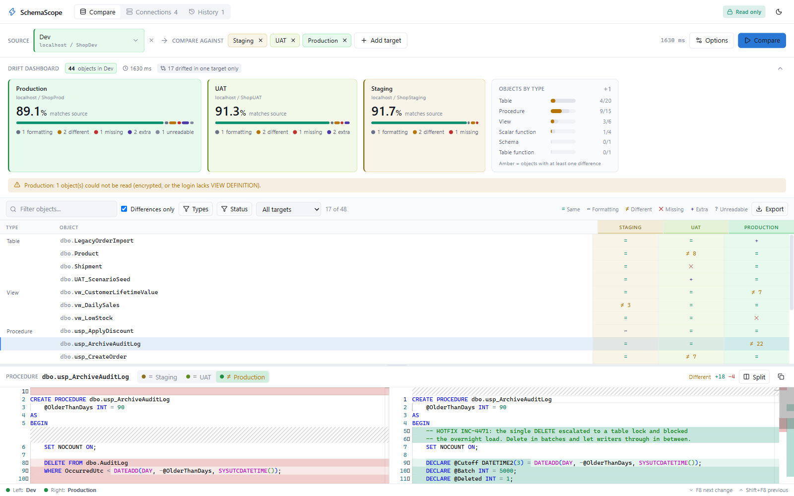
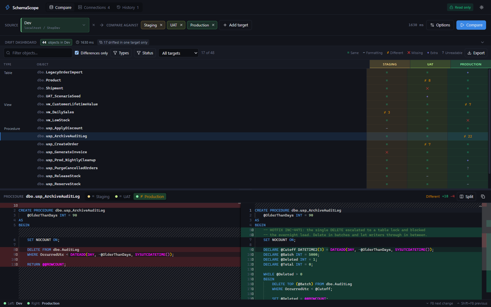
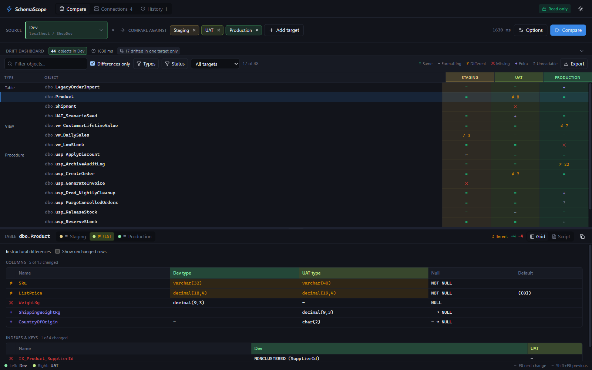

<p align="center">
  
</p>

<h1 align="center">SchemaScope</h1>

<p align="center">
  <b>Compare one SQL Server database against all your environments at once — in about a second.</b>
</p>

<p align="center">
  <a href="https://schemascope.shadowmark.in"><b>schemascope.shadowmark.in</b></a>
  &nbsp;·&nbsp;
  <a href="https://github.com/Shrikant-satpute/schemascope/releases/latest/download/SchemaScope-Setup.exe"><b>Download for Windows</b></a>
  &nbsp;·&nbsp;
  <a href="SECURITY.md">Security</a>
</p>

<p align="center">
  <a href="LICENSE"></a>
  <a href="../../actions/workflows/ci.yml"></a>
  
</p>

---

<p align="center">
  <picture>
    <source media="(prefers-color-scheme: dark)" srcset="assets/screenshots/dashboard-dark.png">
    
  </picture>
</p>

<p align="center"><i>One source, three environments, one screen. Dev on the left, everything that drifted on the right.</i></p>

---

## What it does

You have one database you trust — call it Dev. You also have Staging, UAT and
Production, and you are not completely sure they still match.

SchemaScope answers that in one shot. Pick the source, add as many targets as
you want, press **Compare**. You get:

- a score per environment — *"Production is 89.1% the same as Dev"*
- a list of every object that is different, missing, or extra
- the actual difference, side by side, in the VS Code editor

**Read-only by default.** Every time SchemaScope starts, it only reads: you
get scores, diffs, scripts and reports, and what you do with them is your call.
If you want SchemaScope to apply the fix scripts itself, you switch on
**Read & write mode** for that session — it is off on every launch, turns itself
off after 30 idle minutes, and every apply is gated. See
[Apply scripts directly](#apply-scripts-directly).

---

## Why not just use Visual Studio?

Straight answer: **Visual Studio's Schema Compare sucks at this job.**

It is fine at what it was built for — pushing one database into another. Ask it
the question people actually ask on a Friday afternoon, *is production still the
same as dev?*, and it wastes your afternoon.

- **It is slow. Every single time.** Before it says one word, it builds a full
  model of both databases. On a big database that is minutes of watching a
  progress bar, and you pay it again on every run.
- **One pair at a time. That is it.** Four environments means running it four
  times, waiting four times, and then holding four sets of results in your head.
- **It cries wolf.** Re-indent a stored procedure and it screams "changed". The
  one difference that will actually break production is buried in that noise.
- **It drags a whole IDE along.** A DBA who does not write C# should not have to
  install a multi-gigabyte IDE to find out whether last night's release landed.
- **It is the wrong tool pointed at production.** Schema Compare exists to write
  to a database. If all you wanted was an answer, that is a lot of loaded gun to
  be holding.

SchemaScope does the one job, properly. Measured on a real 1,189 object database
against a 990 object copy:

| | SchemaScope | VS Schema Compare |
|---|---|---|
| Read both databases | 500 ms | — |
| Compare and classify | 296 ms | — |
| **Total** | **806 ms** | **60–180 seconds** |
| Targets per run | as many as you like | one |
| Needs Visual Studio | no | yes |

Four target databases take about the same time as one, because they are read at
the same time.

### How it is that fast

1. **Read the catalog, not the model.** Two round trips per database: check the
   version, then one batch that returns everything. Never one query per object.
2. **Never read the same procedure body twice.** Bodies are the only thing here
   that touches LOB pages, and on a server whose buffer pool is under pressure
   they are the entire cost of a compare. They are kept between runs and re-read
   only when `sys.objects.modify_date` says the object has actually been altered,
   so a third round trip fetches the handful that changed and is skipped when
   none did. On a 1,170 against 1,193 object pair, on an instance squeezed down
   to a 555 MB buffer pool: **25.9 s on the first run, 1.8 s on the next**, with
   an identical answer both times.
3. **Hash first, look later.** Every object gets a SHA-256 of its cleaned-up
   text. Same hash means the object is identical, and it is never opened again —
   that is usually 90% or more of the database.
4. **Compare tables as data, not as text.** Columns, indexes and constraints are
   built from catalog metadata by the *same code* on both sides, so formatting
   can never invent a fake difference.
5. **Do all targets at once**, in parallel.
6. **Run the expensive check last.** The T-SQL parser only runs on bodies that
   already look nearly identical. Skipping it on the obviously different ones
   took the compare stage from 1693 ms down to 296 ms.
7. **Stream results to the screen** as each database finishes.

---

## Six answers, not two

Most tools say "same" or "different". That is why a re-indented procedure looks
like a change and the real one gets buried.

| | Status | What it means |
|:-:|---|---|
| `=` | Same | Identical to the source |
| `~` | Formatting | Same code. Only spacing, comments or brackets moved |
| `≠` | Different | A real difference, with the number of changed lines |
| `✕` | Missing | In the source, but not in this target |
| `+` | Extra | Only in this target — usually a local change |
| `?` | Unreadable | Encrypted, or your login lacks `VIEW DEFINITION` |

Nothing is ever hidden. An ignore rule moves an object down to *Formatting*
instead of making it disappear.

Every status has a symbol and a word as well as a colour, and the colours are
checked for colour blindness in both light and dark mode.

---

## What you see

### Real diffs, in the VS Code editor

<p align="center">
  
</p>

Monaco — the editor from VS Code — with real line numbers, side by side or
inline. `F8` and `Shift+F8` jump between changes.

### Tables compared field by field

<p align="center">
  
</p>

A text diff lights up a whole `CREATE TABLE` when one column is renamed. The
grid shows you only the cells that actually differ — plus indexes, keys and
constraints.

### And the rest

- **Drift dashboard** — one tile per environment: how much still matches, a
  breakdown bar, and counts you can click to filter.
- **"Drifted in exactly one target"** — objects that changed in a single
  environment. Almost always a local change rather than a missed release.
- **Matrix grid** — one row per object, one column per target. Virtualized, so
  thousands of rows stay smooth. The filter box works like SQL `LIKE '%...%'`:
  part of a name is enough, several words must all appear in any order, and
  `%` or `*` stands for any characters (`EY%Logs`).
- **Where is this used?** — pick an object and see what references it, and what
  it uses, in the source and in every target. The answer can differ between
  environments, which is itself the finding.
- **Export** — a standalone HTML report, CSV, Markdown for the wiki, or one
  `.sql` file per object into a folder.
- **Create scripts** — the SQL that would make a target look like the source,
  as numbered folders you review and run yourself. See [Create scripts](#create-scripts).
- **Generate a script for one object** — from the diff panel, the script for
  just that object, with the prerequisites it needs.
- **Apply scripts directly** — opt-in, per session, with the target's name typed
  before every run. See [Apply scripts directly](#apply-scripts-directly).
- **Swap source and target** — one click (`Alt+Shift+S`) to compare the other
  way round.
- **Share on your network** — send a colleague a read-only link to a finished
  comparison. See [Share on your network](#share-on-your-network).

---

## Share on your network

A finished comparison can be handed to someone else on the same network as a
link, so they can read the dashboard, the matrix and every diff in their own
browser without installing anything or having a login on your servers.

1. Run a compare, then click **Share**.
2. Send the link it shows you, for example
   `http://192.168.1.20:5280/s/<token>`. The Share tab lists your live links and
   who is reading them right now.
3. **Revoke** a link whenever you like. Links also expire on their own after
   seven days.

How it is kept contained:

- **Off until you use it.** Nothing listens on the network until you share. The
  listener stops when you revoke the last link, when the last one expires, and
  when you close SchemaScope.
- **A separate, read-only server.** The link is served by a second listener on
  port 5280 that only knows a handful of `GET` routes for the shared snapshot.
  Your connections, passwords, history and the compare and script routes are not
  on it at all — they stay on the token-protected loopback API.
- **The link is the key.** Each link carries a 128-bit random token, compared in
  constant time. Wrong guesses are rate limited, and so is everything else.
- **A snapshot, not a connection.** The shared copy is written when you click
  Share. It never goes back to a database, and it never contains a connection
  string or password; driver error messages are scrubbed before they are
  written.
- **Windows Firewall.** If others cannot reach the link, the Share tab offers to
  add a rule. It is limited to private and domain networks, to callers on your
  local subnet, and to SchemaScope itself, and the exact `netsh` command is shown
  before you click. To remove it later:
  `netsh advfirewall firewall delete rule name="SchemaScope share"` from an
  admin prompt.

Be clear about what a link hands over: **the full text of every object in the
comparison**, plus the server and database names, over plain HTTP, to anyone who
has the link and can reach your machine. Share it the way you would share the
`.sql` files themselves. Shared snapshots are kept in
`%LOCALAPPDATA%\SchemaScope\shares` until they are revoked or expire.

---

## Your schema stays on your machine

This is built in, not promised in a policy document:

- Connections and passwords live in
  `%LOCALAPPDATA%\SchemaScope\schemascope.db`. Passwords are encrypted with
  Windows DPAPI under your account, so no other Windows user can read them.
- The UI is served from inside the exe, under a
  `Content-Security-Policy` of `default-src 'self'`. A request to an outside
  host is not blocked by our code — the browser engine refuses to make it.
- The local API only answers its own window: every call must carry a token
  minted at startup, and requests addressed to any other host name are refused.
- Saved passwords are only ever used for the server and login they were saved
  with. Point a saved connection somewhere else and you have to type it again.
- The window will not navigate anywhere except its own loopback address.
- Procedure and view bodies are cached in `%LOCALAPPDATA%\SchemaScope\cache` so
  an unchanged one is never read twice. It is object text, not data, it never
  leaves the machine, and deleting the folder costs nothing but the next run's
  time.
- No telemetry. No update check. The only outgoing connections it opens are to
  the databases you named. Nothing listens on the network unless you
  [share a comparison](#share-on-your-network) — and then only the read-only
  viewer, until you stop.
- Read-only by default. The one path that changes a database is
  [Read & write mode](#apply-scripts-directly): off on every launch, never
  saved, owner window only. A shared link can never write and never shows it.

---

## Installing

[**Download SchemaScope-Setup.exe**](https://github.com/Shrikant-satpute/schemascope/releases/latest/download/SchemaScope-Setup.exe)
and run it. It installs for your account only, so Windows never asks for
administrator rights, and it offers a desktop shortcut.

Prefer nothing installed? [`SchemaScope.exe`](https://github.com/Shrikant-satpute/schemascope/releases/latest)
is the portable build — one self-contained file, no .NET install needed, nothing
to unpack, no files beside it.

### From Scoop

```powershell
scoop install https://raw.githubusercontent.com/Shrikant-satpute/schemascope/main/packaging/scoop/schemascope.json
```

This installs the portable build and keeps it up to date with `scoop update`. It
also skips the SmartScreen warning below — that warning comes from a mark
browsers attach to downloaded files, and a package manager never adds it.

WebView2 is required and ships with Windows 10 and 11. If it is somehow missing,
you get a plain explanation and a download link.

### Windows will warn you the first time

The binaries are not code-signed yet, so SmartScreen shows *"Windows protected
your PC"*. Click **More info**, then **Run anyway**.

You do not have to take that on trust. Every release is built in public by
GitHub Actions from the tagged commit, and ships a `SHA256SUMS.txt`:

```powershell
Get-FileHash .\SchemaScope-Setup.exe -Algorithm SHA256
```

### What it needs on the server

A login that can read the catalog:

```sql
GRANT VIEW DEFINITION TO [your_login];
```

Without it, SchemaScope still sees object names but not their bodies. It says so
per object instead of reporting a false difference, and the connection test
warns you up front.

---

## Building

```powershell
.\build.ps1              # front end + single file exe -> dist\SchemaScope.exe
.\build.ps1 -SkipWeb     # C# only
```

Needs the .NET 9 SDK and Node 20+.

### Working on the front end

```powershell
# terminal 1 - the API on a fixed port
dotnet run --project src\SchemaScope.Shell -- --server --port 5199

# optional: a throwaway settings store, so you never touch your own connections
dotnet run --project src\SchemaScope.Shell -- --server --port 5199 --store C:\temp\scratch.db

# terminal 2 - Vite with hot reload, proxying /api to 5199
cd web
npm run dev
```

### Measuring the engine

The Phase 0 spike is still in the repo. It reports stage timings and, more
usefully, every object that differs *only* by formatting — each one is a
normalizer rule worth reviewing before trusting the tool on a new database.

```powershell
dotnet run --project src\SchemaScope.Spike -c Release -- `
  -s "Server=localhost;Database=Dev;Integrated Security=true;TrustServerCertificate=true" `
  -t "Server=localhost;Database=Prod;Integrated Security=true;TrustServerCertificate=true"
```

---

## Layout

```
src/
  SchemaScope.Core        models, T-SQL normalizer, hashing, diff engine, local store
  SchemaScope.SqlServer   catalog reader, connection handling
  SchemaScope.Scripting   Create scripts: folder generators, offline validator
  SchemaScope.Api         minimal API + SSE, share viewer, embeds the built UI
  SchemaScope.Shell       WebView2 window, single file exe entry point
  SchemaScope.Spike       Phase 0 measurement console
web/                      React + TypeScript + Vite + Tailwind + Monaco
site/                     the landing page at schemascope.shadowmark.in
tests/                    xUnit: engine, normalizer, and the security rules
```

Works with SQL Server 2012 and later, Azure SQL Database, Azure SQL Managed
Instance and AWS RDS. The catalog queries adjust to the server version.

---

## Create scripts

After a compare, each target tile has a **Create scripts** button. It writes the
SQL that would make that target look like the source, as numbered folders.
Creating scripts **runs nothing**: SchemaScope only reads the two databases
(catalog `SELECT`s and row counts) and checks the scripts offline. You review
them and run them yourself — or, with Read & write mode on,
[apply them from the app](#apply-scripts-directly).

1. Run a compare, then click **Create scripts** on the target's tile.
2. Untick what you do not want. Everything is ticked except **Table types**,
   **Triggers** and **Different code**, which change how the running
   application behaves.
3. Click **Generate** and pick a folder. The run goes into
   `<folder>\<Target>_<yyyyMMdd-HHmm>\`. Its `README.md` explains each folder.

| Folder | What it does | Run by `RUN.ps1` |
|---|---|---|
| `01_columns` | Adds missing columns to tables both sides have | yes |
| `02_tabletypes` | Rebuilds changed table types (drops and recreates the procedures that use them) | only with `-WithTableTypes` |
| `03_missing` | Creates missing tables, functions, views, procedures, schemas, sequences, synonyms | yes |
| `04_columntypes` | Widens columns and relaxes NOT NULL; never narrows | yes (first) |
| `05_constraints` | Adds missing defaults, checks, keys and foreign keys | yes |
| `06_indexes` | Adds missing indexes | yes |
| `07_triggers` | Creates missing triggers | no - run on its own |
| `08_formatting_modules` | Replaces modules that differ only by formatting, with a `rollback\` | no - run on its own |
| `09_formatting_tables` | Renames names that differ only by letter case (`sp_rename`) | no - run on its own |
| `10_different_modules` | Replaces procedures, views, functions and triggers whose code really differs, with a `rollback\` | no - run on its own |
| `11_destructive` | Changes that can lose data. Only written when you ask for it, which needs Read & write mode on | no - run on its own |
| `99_review` | Reports only: everything held back, and why | - |

```powershell
powershell -ExecutionPolicy Bypass -File .\RUN.ps1 -Database <TargetDatabase> [-Server <name>] [-WithTableTypes]
```

What it is careful about:

- **Module text is byte for byte.** Procedure, function and view bodies come out
  exactly as the source has them, even through SSMS. The offline check proves
  it for every module.
- **Nothing that can lose data unless you ask.** `04` never narrows a column.
  Changes that can lose data go only into `11_destructive`, which is off unless
  you turn on Read & write mode and tick it.
- **Anything risky is held back, not scripted**: a NOT NULL column with no
  default, a key that existing data would break, a procedure that would not
  compile on the target, a module that reads a column the target will not get,
  and so on. Each one is listed in `99_review` with the reason.
- **No connection details in any file.** `RUN.ps1` uses your Windows login.
- **Only into a local folder you chose.** Network paths, and system and Startup
  folders, are refused, so a `RUN.ps1` can never land somewhere it would run by
  itself.
- If you stop a run, the folder gets an `INCOMPLETE - DO NOT RUN.txt` marker.

Always run the scripts on a restored copy of the target first, then compare
again, before touching the real one.

---

## Apply scripts directly

SchemaScope is read-only by default. If you would rather not leave the app to
run the scripts, switch on **Read & write mode**, and the script dialog gains an
**Apply to &lt;target&gt;** button. It is built so that it cannot happen by
accident:

- **Off on every launch.** The switch lives only in the running app's memory.
  It is never saved, it needs a confirmation to turn on, and it turns itself off
  after 30 idle minutes. While it is on, an amber strip across the
  window says so, with a **Turn off** button.
- **Type the database name.** Before every apply you type the target
  database's name. The server checks it against the connection it is about to
  use, and against `DB_NAME()` on that connection once it is open.
- **Protected servers are never touched.** Mark a connection
  **Protected — never apply scripts here** and applying to it is refused, even
  with Read & write mode on. The source database is never an apply target.
- **The same safe defaults as `RUN.ps1`.** Only `04`, `01`, `03`, `05` and `06`
  are ticked. Table types, triggers, formatting and different code start
  unticked, each with its warning. Anything held back in `99_review` is never
  applied.
- **Data loss is a separate decision.** *Include changes that can lose data*
  (in **Create scripts**) is off by default and only shows while Read & write
  mode is on. The `11_destructive` section then starts unticked and needs a
  second *I understand this can lose data* tick. Each column change in it checks
  the data again when it runs and stops, changing nothing, if a row written
  since no longer fits.
- **One transaction per file.** Each script file runs in its own transaction.
  The first error rolls that file back and stops the run. **Files before it
  stay applied** — SchemaScope says so, and shows you which ones. Every file is
  re-checked against the hash recorded when it was written before anything
  runs, so an edited script is refused. Files that touch memory-optimized
  tables or natively compiled code cannot run inside a transaction, so an
  apply that includes them is refused; run those with `run_all.ps1`.
- **Stop, or cancel now.** *Stop after this file* lets the running file finish.
  *Cancel this file now* — or turning Read & write mode off — cancels the
  running file too, and it is rolled back, for a file stuck waiting on locks.
- **Compare again, automatically.** When the apply finishes, the compare runs
  again, so you see the new score straight away.
- **An audit trail.** Every apply — when, which server, database and login,
  which sections, and the result of each file — is recorded in the local
  settings database, with connection secrets and passwords left out.

Applying runs DDL as the target connection's own login, so it can do what that
login can do. Rehearse on a restored copy first, exactly as with `RUN.ps1`. The
details are in [SECURITY.md](SECURITY.md#write-mode).

What a default apply gets you: the `RUN.ps1` set — new columns, missing
objects, widened columns, constraints and indexes. What still needs you is
listed rather than guessed: table types, triggers, formatting, case renames and
different code are opt-in sections; changes that can lose data need their own
tick; and anything held back in `99_review` is never applied — code that is
broken in the source, a NOT NULL column with no default, a key existing data
would break, a module that reads a column the target will not get.

---

## Not in this version

Data migration. The scripts change structure only; they never move or fix rows.

---

## Links

- **Website** — <https://schemascope.shadowmark.in>
- **Download** — [latest release](https://github.com/Shrikant-satpute/schemascope/releases/latest)
- **Report an issue** — <https://github.com/Shrikant-satpute/schemascope/issues>

## Contributing

See [CONTRIBUTING.md](CONTRIBUTING.md) for the build, the dev loop and where
tests are expected. Found a security issue? [SECURITY.md](SECURITY.md) — please
report it privately rather than in an issue.

## License

[Apache-2.0](LICENSE). Built by [Shadowmark](https://shadowmark.in).
